# Power Platform Toolbox

**18 tools for Dynamics 365 and the Power Platform, right inside the pages you
already work in.** Deploy solutions, browse and edit records, debug flows and
always see which environment you are in, all from one command palette.

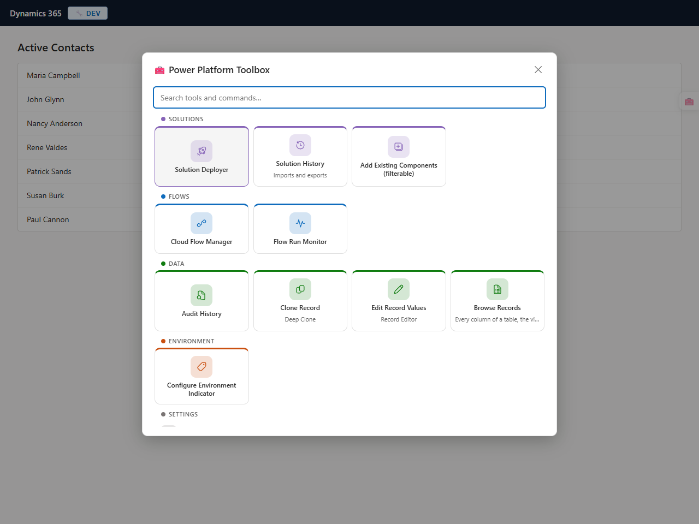

> 🔒 **No data collected, nothing leaves your browser.** The extension has no
> server and no analytics. It only talks to your own Dynamics 365 and Power
> Platform environments (and to Jira and Clockify, if you switch those tools
> on), using the sign-in you already have. See [PRIVACY.md](PRIVACY.md).

**Who it is for:** makers, consultants, admins and developers working in
Dynamics 365 model-driven apps, Power Apps and Power Automate. Everything it
does, you are already allowed to do. The toolbox just makes it quicker.

- [Install](#install)
- [Getting started](#getting-started)
- [The tools](#the-tools): [Environments](#environments) · [Data](#data) · [Solutions](#solutions) · [Flows](#flows) · [Time tracking](#time-tracking-optional)
- [Settings](#settings)
- [Questions and troubleshooting](#questions-and-troubleshooting)

## Install

Works in **Google Chrome** and **Microsoft Edge**.

The Chrome Web Store listing is in review. Until it is live, install it from
the latest release. It takes about a minute:

1. Download **`power-platform-toolbox-extension.zip`** from the
   [latest release](https://github.com/AhashSritharan/power-platform-toolbox/releases/latest)
   and unzip it into a folder you will keep. The browser loads the extension
   from that folder, so don't delete it.
2. Open the extensions page: type `chrome://extensions` (Chrome) or
   `edge://extensions` (Edge) in the address bar.
3. Turn on **Developer mode** (top right in Chrome, left side in Edge).
4. Click **Load unpacked** and pick the folder you unzipped.
5. Pin the toolbox to the toolbar: click the puzzle-piece icon and then the pin
   next to *Power Platform Toolbox*.

To update later, download the new zip, replace the folder's contents and click
the reload icon on the extension's card.

## Getting started

### 1. Setup (one minute)

Right after installing, a setup page opens. It asks three things:

**Which tools you want.** Everything for Dynamics 365 and the Power Platform is
on. The Jira and Clockify tools are off until you need them.

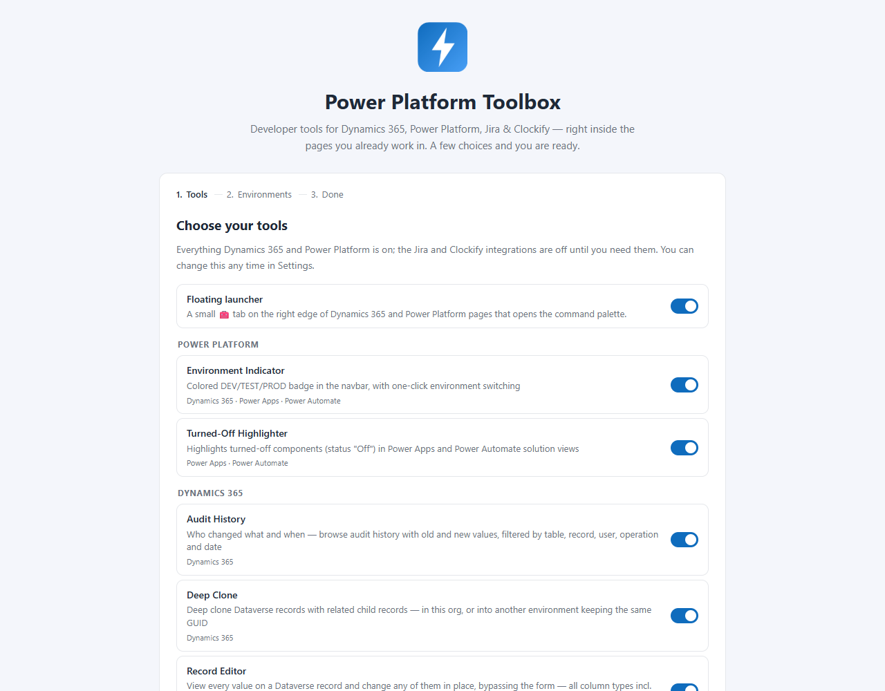

**A label for each environment.** Click **Find my environments**. The
toolbox opens the Power Apps maker portal in a background tab, reads the list
of environments you have access to, and closes the tab again. It suggests
DEV / TEST / PROD from each environment's type, and you can change any
of them. These labels drive the coloured badge on every page and the
environment pickers in the deploy, clone and flow tools.

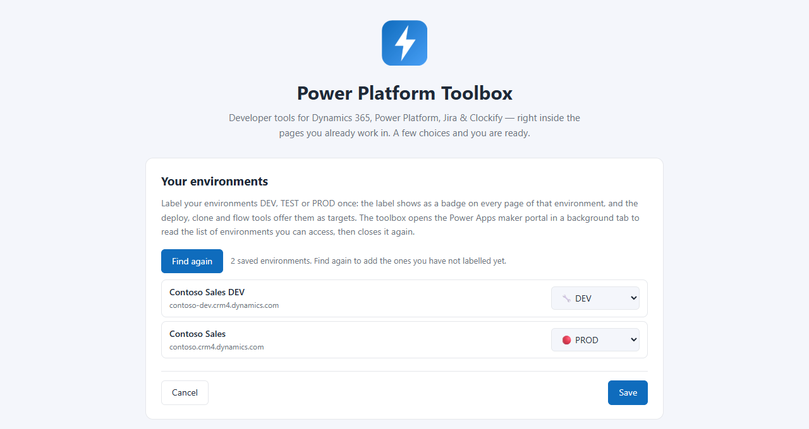

**Clockify**, only if you switched a Clockify tool on: your API key, workspace
and how to round durations.

You can skip any step and come back to it: setup is available from the
options page and from the palette (**Run setup**).

### 2. Open a tool

Go to any Dynamics 365 app (`*.dynamics.com`), [make.powerapps.com](https://make.powerapps.com)
or [make.powerautomate.com](https://make.powerautomate.com). There are three
ways to open the toolbox:

- Press **`Alt+Shift+P`** for the command palette. Start typing to filter
  it, e.g. "browse".
- Click the small **🧰 tab** on the right edge of the page. Drag it up or down
  if it is in the way.
- Click the **toolbar icon**. It lists the same commands for the page you
  are on.

The palette only shows the tools that work on the current page. A record form
offers the Record Editor, the flow designer offers Find All References, and so
on.

## The tools

| | Tool | Where | In one line |
|---|---|---|---|
| 🏷️ | [Environment Indicator](#environment-indicator) | Everywhere | A DEV/TEST/PROD badge on every page, and one-click switching |
| 📋 | [Record Browser](#record-browser) | Dynamics 365 | Every record and every column of a table, no view to edit first |
| ✏️ | [Record Editor](#record-editor) | Dynamics 365 | Change any value on a record, bypassing the form |
| 🧬 | [Deep Clone](#deep-clone) | Dynamics 365 | Copy a record with its child records, even into another environment |
| 🔍 | [Audit History](#audit-history) | Dynamics 365 | Who changed what, and when, field by field |
| 🚀 | [Solution Deployer](#solution-deployer) | Dynamics 365 & maker portals | Deploy a solution to another environment, check dependencies first |
| 🗂️ | [Solution History](#solution-history) | Dynamics 365 & maker portals | Live import progress, failure logs, every past export |
| ➕ | [Add Existing Components](#add-existing-components) | Dynamics 365 & Power Apps | "Add existing" with a grid you can sort and filter |
| 🚦 | [Turned-Off Highlighter](#turned-off-highlighter) | Maker portals | Turned-off components stand out in solution views |
| ⚡ | [Cloud Flow Manager](#cloud-flow-manager) | Dynamics 365 & maker portals | Turn a solution's flows on or off, one at a time or in bulk |
| 📈 | [Flow Run Monitor](#flow-run-monitor) | Dynamics 365 & maker portals | Every run across all flows, filtered, charted and traced to the flow that broke |
| 🔗 | [Find All References](#find-all-references) | Power Automate | `Shift+F12`: what uses this step or variable |
| ✅ | [Expression Validator](#expression-validator) | Power Automate | Finds expressions that point at actions that don't exist |
| 🧩 | [Parse JSON Schema Builder](#parse-json-schema-builder) | Power Automate | Dynamic content back for List rows with child records |
| ▶️ | [Run Page Actions](#run-page-actions) | Power Automate | Run tree, open child run, re-run and download on run pages |
| 🔀 | [Classic Relationship Dialog](#classic-relationship-dialog) | Power Apps | The classic relationship dialog, back on the Relationships page |
| ⏱️ | [Jira Clockify Timer](#jira-clockify-timer) | Jira Cloud | Start and stop a Clockify timer from a Jira issue (off by default) |
| 🕐 | [Clockify → Dynamics 365 Sync](#clockify--dynamics-365-sync) | Dynamics 365 | Import Clockify time entries (off by default) |

### Environments

#### Environment Indicator

Never deploy to the wrong environment again. Once an environment is labelled,
a coloured badge (🔧 DEV, 🧪 TEST, 🔴 PROD and more) sits next to the Dynamics 365 or
Power Apps title on every page of it.

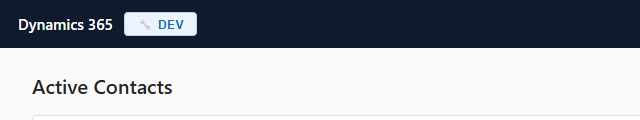

**Click the badge** to change the label, rename it, or **Switch** to another
of your environments in the same place. Environments with similar names are
grouped (here all three *Contoso Sales* environments), and you can rename or
reorder the groups. On the maker portals, **Open** takes you to an
environment's Dynamics 365 app in a new tab.

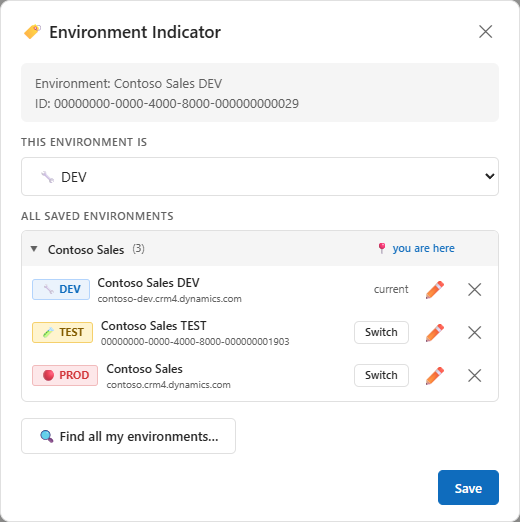

Labels come from setup. To add environments later, click **Find all my
environments…** in this dialog.

### Data

#### Record Browser

*Palette: **Browse Records***

Every record of a table with every column, without creating or editing a view.

- Opened on a list, it starts from **the view you are on**: its columns come
  first, and its filter shows as a chip you can remove to see every record.
- **Search** looks in all columns at once and highlights the matches.
- Click a **column header** to sort or to filter it, with operators that fit
  the column type (begins with, on or after, in the last N days, is me…).
- **Columns** picks what is shown, **Hide empty** drops columns with no value,
  **Export CSV** saves what you see.
- File columns download and image columns show a thumbnail.
- **Click a row** to open it in the Record Editor.

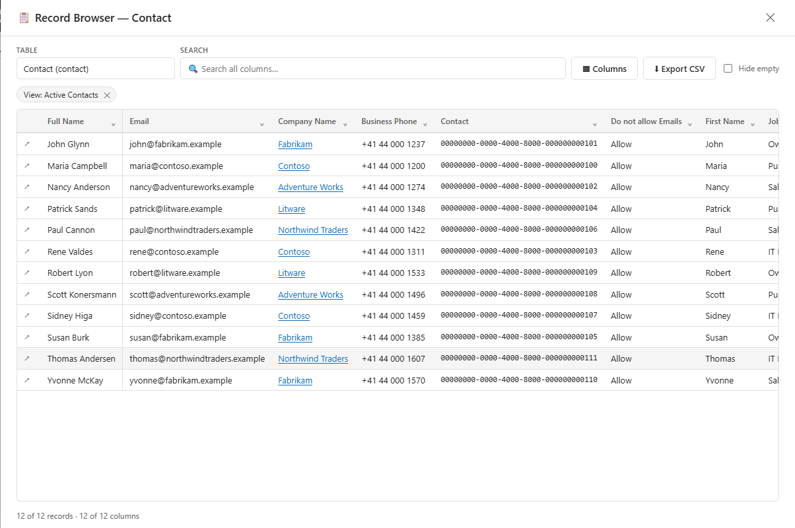

#### Record Editor

*Palette, on a record: **Edit Record Values***

Every value on the record, including the ones the form doesn't show, and you
can change any of them in place.

- Click a value to edit it. Text, numbers, dates, choices, yes/no and lookups
  are all supported. **Set Null** clears a value.
- Changes are collected (*1 pending change*) and saved together with
  **Save Changes**. If Dataverse refuses, you see its own error message and
  your edits are kept.
- Read-only columns are marked 🔒. Filter by name or value, hide empty columns,
  or show only what you changed.

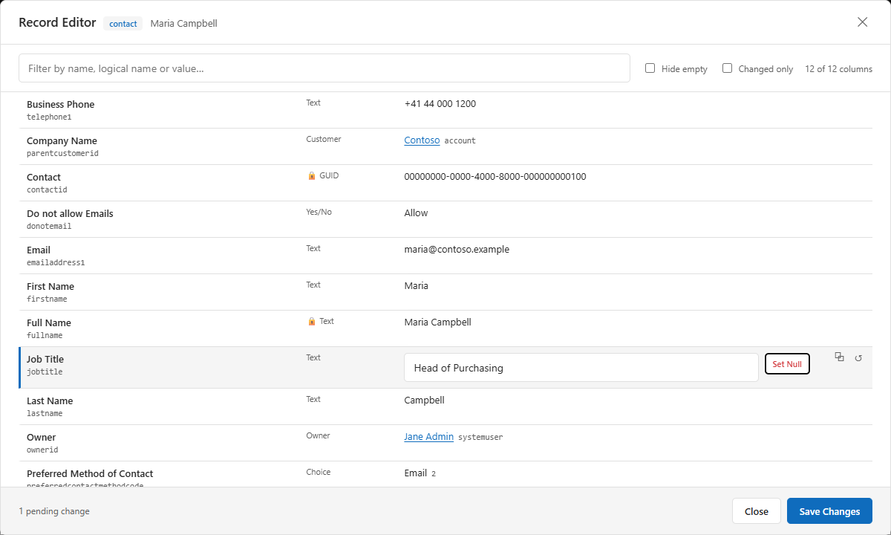

#### Deep Clone

*Palette, on a record: **Clone Record***

Three ways to copy the record you are on:

- **Open as New**: a new form pre-filled with this record's values. Nothing is
  saved until you save it.
- **Deep Clone**: the record **and the child records you tick** (e.g. an
  account with its contacts), created in one go. **Preview** shows what will
  be written first.
- **To Environment**: copies the record into another environment you are signed
  in to, optionally **keeping the same GUID**. That is useful for reference
  data that has to match across DEV, TEST and PROD.

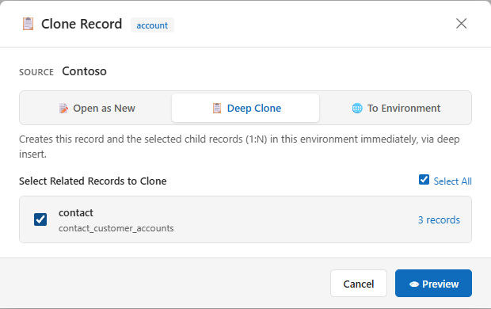

#### Audit History

*Palette: **Open Audit History***

Who changed what, and when. On a record, it shows that record's history; old
and new values are side by side for every field. Filter by user, operation and
date (with *Today*, *7 / 30 / 90 days* shortcuts). Changes made on someone's
behalf show both names, and lookups link to the record.

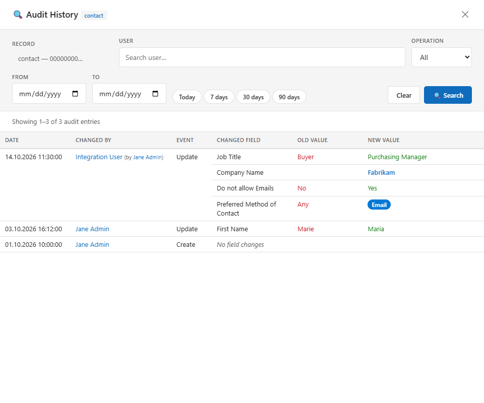

If you don't have permission to read audit history, it says so instead of
failing.

### Solutions

#### Solution Deployer

*Palette: **Open Solution Deployer***

Move a solution from the environment you are on to another one, without
downloading and uploading zips by hand.

1. **Deploy** → **Existing Solution** → pick the solution.
2. **Next: Choose Target**: pick one of your labelled environments, or paste
   its URL. Optionally import *as another user* (e.g. a pipeline application
   user) so the components are owned by them.
3. **Deploy Now**: it exports the solution, imports it into the target and
   publishes. A confirmation names the target first, so a PROD deployment
   never happens by accident.

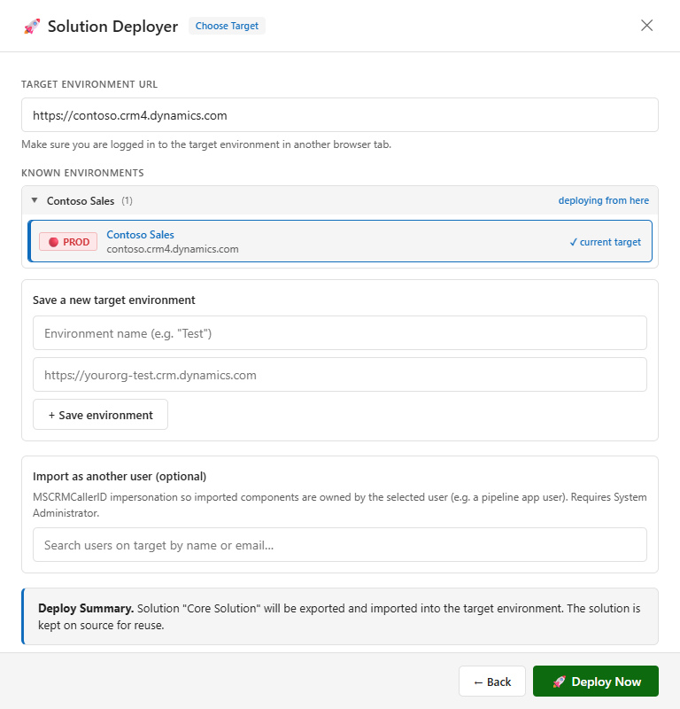

**Check Deps** runs before a deployment and tells you what the target is
missing: tables, option sets, flows a canvas app calls, and so on. **Add**
puts a missing component into your solution on the source, and **Add All Missing** adds all of
them.

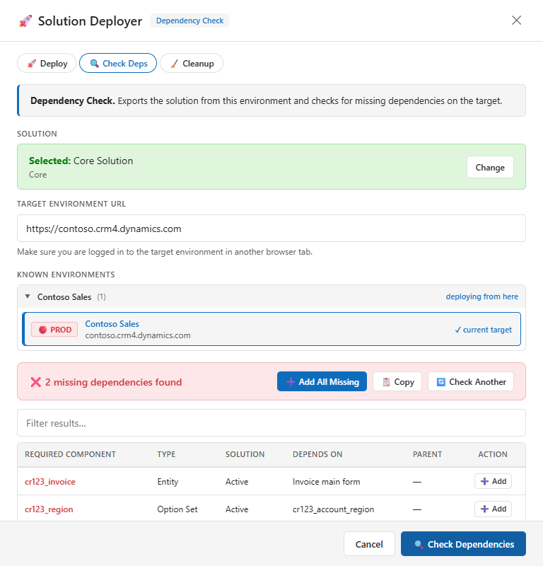

**Cleanup** removes the unmanaged solution from the target after you have
deployed the managed version, so it no longer shows up there.

You must be signed in to the target environment in another tab. The
toolbox uses your existing sign-in and never asks for a password.

#### Solution History

*Palette: **Open Solution History***

- **Imports**: imports and upgrades that are running right now, with live
  progress, and every completed one with its result. **View** opens the
  import log, filtered to the errors.
- **Exports**: every export the environment still holds, often going back
  years, with **Download** for the original zip.

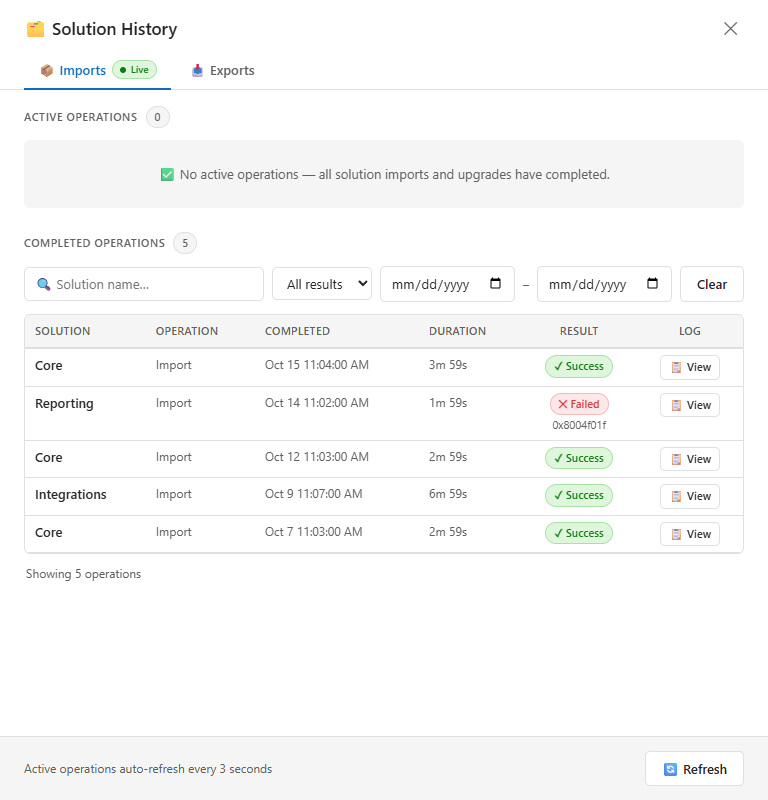

#### Add Existing Components

*Palette: **Add Existing Components (filterable)**, or the **Filter & sort in
Toolbox** button in the maker portal's own "Add existing" panel*

The maker portal's "Add existing" panel, rebuilt as a real grid: pick the
solution and component type, sort on any column (several at once), filter any
column, choose the columns, then tick what you need and **Add to solution** in
one go. Components that are already in the solution are marked. Opened from
make.powerapps.com, it starts on the solution you are viewing.

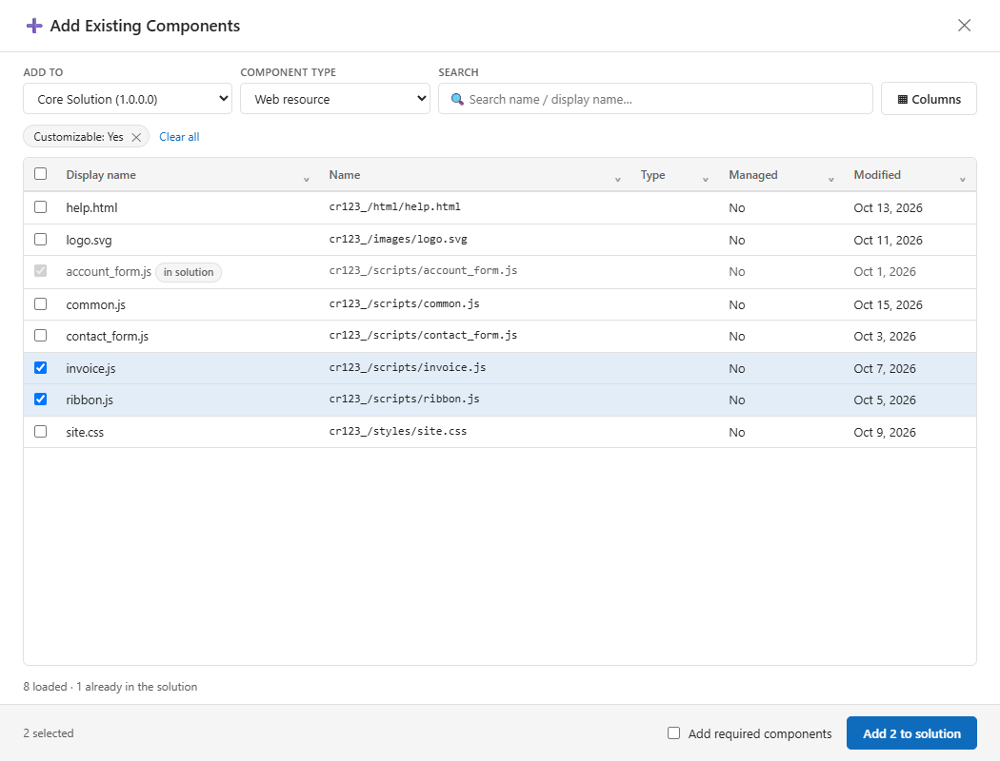

#### Turned-Off Highlighter

Nothing to open. On make.powerapps.com and make.powerautomate.com, every
component whose status is **Off** in a solution view is tinted red, so a flow
or business rule left off after an import is easy to spot. It works in every
portal language.

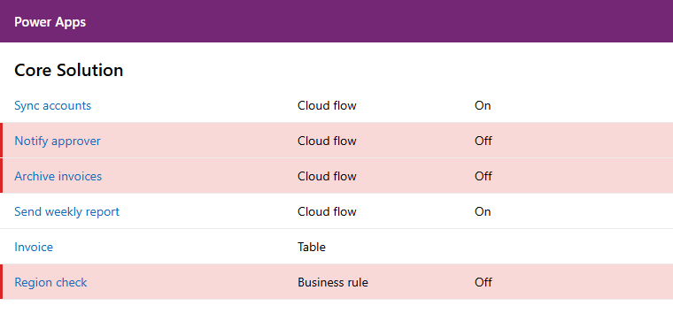

### Flows

#### Cloud Flow Manager

*Palette: **Open Cloud Flow Manager***

Pick a solution and **Load Flows** to see all its cloud flows with their state.
**Turn On / Turn Off** one flow, or tick several and use **Turn On Selected**.
If a flow can't be turned on, you see the reason (e.g. a connection reference
with no connection).

It also flags flows whose connections are set to *"Provided by run-only
user"*: those cannot be called as child flows. **Fix** helps you change them.

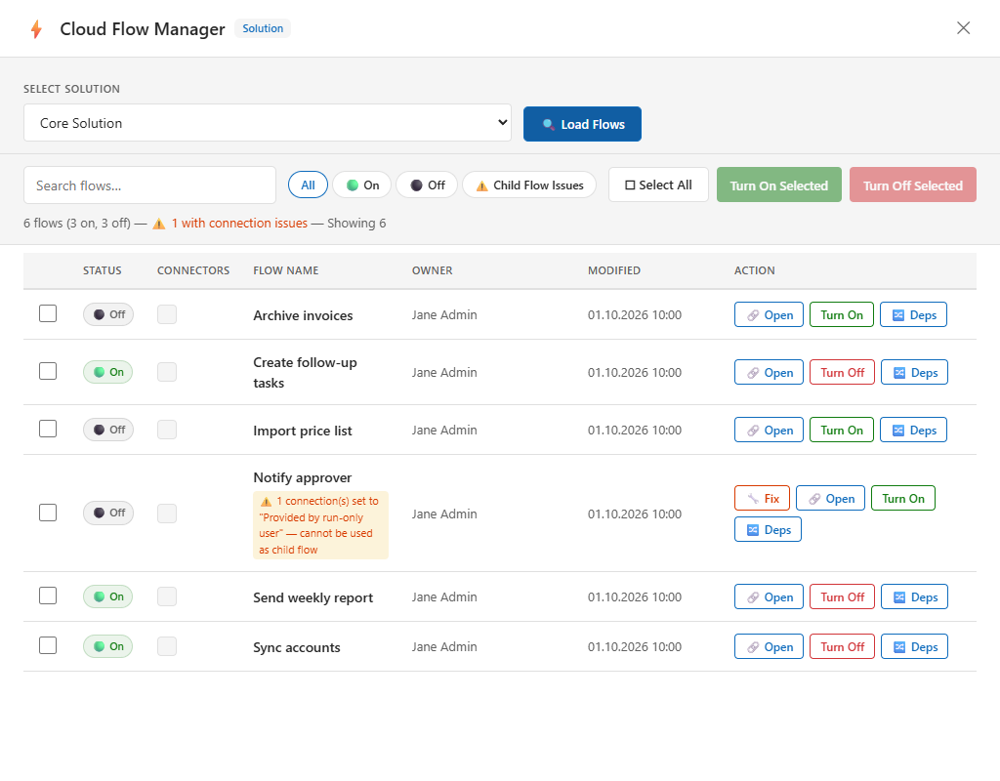

#### Flow Run Monitor

*Palette: **Open Flow Run Monitor***

The runs of every flow in the environment in one place, not one flow at a
time.

- Filter by status, time range (1h / 24h / 7d / 30d or any dates), flow,
  owner, trigger, duration or error code. **Export CSV** saves the result.
- **Timeline**, **Stats** and **Chart** show when runs happen and how
  long they take.
- **Errors** groups failures into incidents. When a parent flow fails because
  a child flow failed, the incident is filed under the child flow that broke,
  even when flows in between caught the error and reported success. Pivot by
  flow, by error, or by who called it.

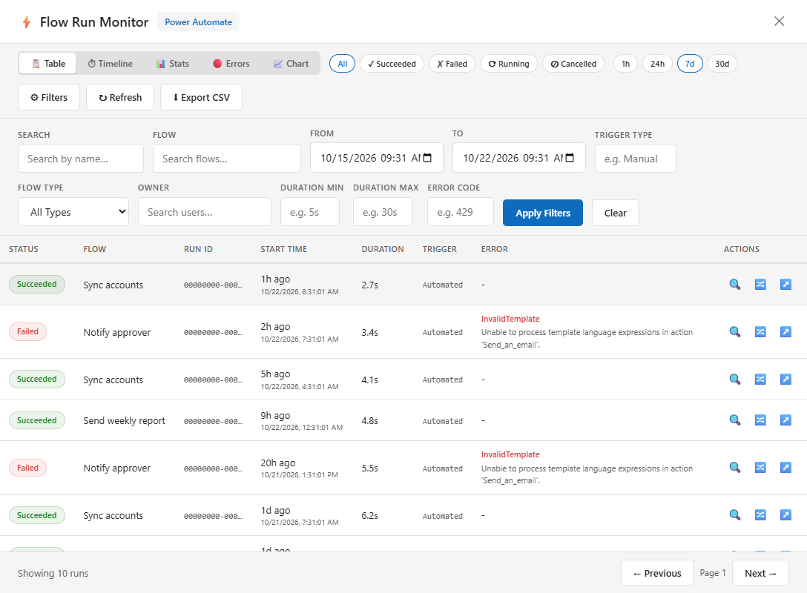

#### Find All References

*In the flow designer: select a step and press **`Shift+F12`**, or palette:
**Find All References***

Like "Find all references" in a code editor. It shows everything that
uses the selected step, trigger or variable: expressions, *run after*
settings, variable writes. **References** shows what the step uses in turn.
Click an entry to follow it, and **⌖ Canvas** selects that step in the designer.

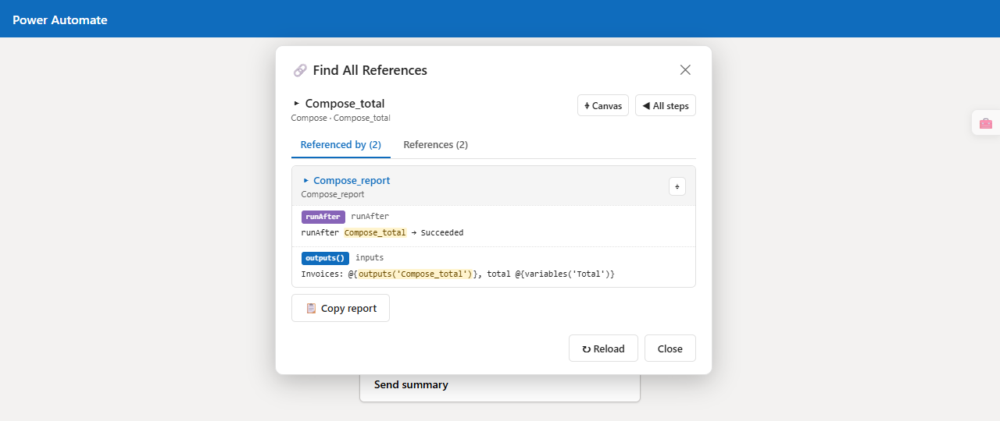

#### Expression Validator

*Palette, in the flow designer: **Validate Flow Expressions***

Renamed a step and something broke? This lists every expression that points
at an action or variable that doesn't exist, where it is, and what it probably
should be.

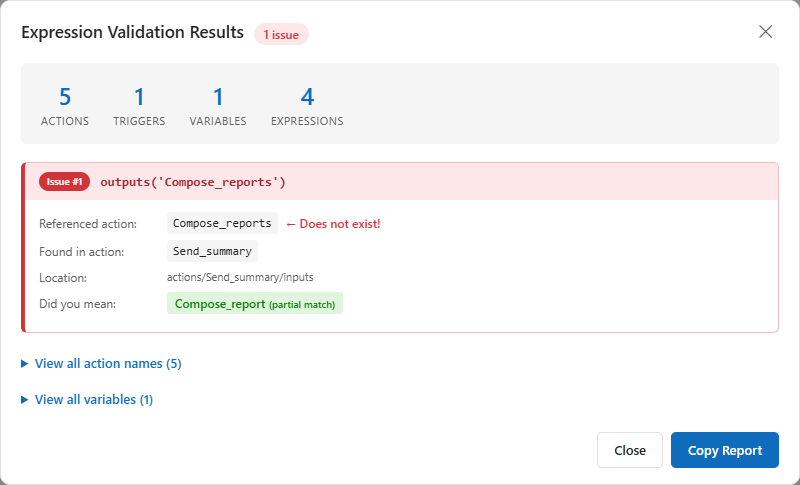

#### Parse JSON Schema Builder

*Palette, in the flow designer: **Field button in the designer: on**, then the
🧬 button next to any input*

For flows that read a Dataverse record **together with its child records**. A
*List rows* query with `$expand` returns an array, and once you unwrap it, the
designer offers no dynamic content any more. This tool reads the query and the
tables' metadata and gives you:

- a ready **Parse JSON schema**, so the dynamic content comes back, named,
  with no *Apply to each* around a single record;
- a **field picker** that inserts any field's expression at your cursor.

#### Run Page Actions

On a Power Automate run page, four extra buttons in the toolbar:

- **Run tree**: the whole chain of connected runs, from the top trigger run
  down to the deepest child run. Each one opens that run.
- **Open run**: jumps straight to the child flow's run behind a "Run a child
  flow" step. For canvas app triggers, it shows who triggered the flow.
- **Re-run**: runs a child flow again with the same inputs, filled in for you.
- **Download**: saves the step's inputs as JSON, plus any files.

#### Classic Relationship Dialog

On a table's **Relationships** page in make.powerapps.com, a **Manage
Relationship** button opens the classic relationship dialog (1:N, N:1, N:N)
for the relationship you pick.

### Time tracking (optional)

Both tools are **off by default**. Turn them on in setup or in the options page,
then enter your Clockify API key once (Clockify → Profile settings → API).
Both tools share the key.

#### Jira Clockify Timer

On a Jira Cloud issue, a button starts and stops a Clockify timer for that
issue. If the issue isn't yet in your working status or assigned to you, it
offers to do both.

#### Clockify → Dynamics 365 Sync

*Palette, in Dynamics 365: **Import from Clockify***

Imports your Clockify time entries into Dynamics 365. You assign the project
and task for each entry, and durations are rounded the way you set up.

## Settings

Right-click the toolbar icon → **Options**:

- switch any tool on or off, or all of them at once;
- turn the 🧰 tab off (the palette is still on `Alt+Shift+P`). You can also hover
  the tab and click × to hide it;
- **Run setup again**, whole or one step at a time.

To change the palette shortcut, open `chrome://extensions/shortcuts` (or
`edge://extensions/shortcuts`).

## Questions and troubleshooting

**I don't see the 🧰 tab or the badge.**
Reload the page once after installing, since tools load when a page opens.
Check that the tool is switched on in Options. The tab only appears on Dynamics
365 and the Power Platform maker portals.

**A tool asks me to sign in, or opens a tab for a moment.**
The maker portals sign you in differently from Dynamics 365. When the
toolbox needs an environment's data on the portal and your browser has no
Dynamics 365 session for it yet, it opens that environment in a background tab
so single sign-on can create one, then closes it. If it can't find the
environment's address, it asks you for it once.

**Does it need admin rights?**
No. Every tool runs as you, with your own permissions. If you can't do
something in Dynamics 365 yourself (read audit history, import a solution), the
tool can't either, and it tells you why.

**Is my password or token stored?**
No. The toolbox never sees passwords or tokens. Requests use the session your
browser already has, the same way the page itself does. It stores only your
settings, such as which tools are on, your environment labels and an
optional Clockify key, locally in your browser.

**Which sites can it access?**
Only `*.dynamics.com`, `*.powerapps.com`, `*.powerautomate.com`, and, for the
optional tools, `*.atlassian.net` and `api.clockify.me`. The full list and what
each is used for are in [PRIVACY.md](PRIVACY.md).

**Something is broken or missing.**
[Open an issue](https://github.com/AhashSritharan/power-platform-toolbox/issues).
Say which tool, on which page, and what you expected. Please leave out
environment names, URLs and record data. Microsoft changes the maker portals
often, and an issue is the fastest way to get a tool working again.

## Contributing

Bug fixes and ideas are welcome. [CONTRIBUTING.md](CONTRIBUTING.md) explains
how the extension is built, how to run it from source and how the tests work.

## License

[MIT](LICENSE)

Tool icons are from [Fluent UI System Icons](https://github.com/microsoft/fluentui-system-icons) by Microsoft, MIT licensed — see [extension/src/core/icons.LICENSE](extension/src/core/icons.LICENSE).
